# GitHub broker architecture

```mermaid
flowchart LR
  claude[Constant Claude CLI] --> contract[Bounded stdin contract]
  codex[Constant Codex CLI] --> contract
  contract --> policy[Canonical default-off runtime policy]
  policy -->|identity| commit[Bot name and noreply email, no key or network]
  policy --> mode{Operation}
  mode -->|mutation| admission[Exclusive durable operation admission]
  mode -->|verify| snapshot[Protected existing snapshot, no lock or state writes]
  snapshot --> key
  admission --> key[Selected protected key loader]
  key --> auth[RS256 JWT and App/installation identity]
  auth --> token[One repository token with the operation's exact permissions, in memory]
  token --> route{Operation}
  route -->|mutation| target[Public repository and target preflight]
  route -->|verify| readback
  target --> intent[Durable write-ahead receipt]
  intent --> write[One fixed issue, pull request or run operation]
  intent -->|branch.push| push[Fixed git push from a clean temporary repository, constructed environment]
  push --> helper[Runtime credential helper: pending locked receipt under 120 s, one grant]
  helper --> ctoken[Contents-write token to git's pipe only]
  ctoken --> ids
  write --> ids[Persist known IDs]
  ids --> readback[Exact target and field readback]
  readback --> safe[Fresh verified result, checked IDs only]
```

`broker.mts` runs one flow for every operation: policy, admission, key,
authentication with the exact permission set from `operations.mts`, then the
operation's handler for preflight, mutation, known IDs, readback and public IDs.
`issues.mts`, `pulls.mts`, `runs.mts` and `git-push.mts` are those handlers.
`git-push.mts` also owns the local preflight (local commit, fast-forward, default
and `v*` branches, bot authorship of every new commit, no `.github/workflows`
path) and the fixed push command, run by system Git from a fixed path with a fixed
child `PATH` (`git-unavailable` when absent). Preflight and push each build a
broker-owned clean bare repository (`mkdtemp`, removed in `finally`) that borrows
only the checkout's objects through alternates, with commit-graph and bitmaps off,
and run git there with a constructed environment, so no configuration, hook, ref,
shallow file, proxy or TLS variable of the session or user applies. The bases of
the fast-forward and authorship checks come from GitHub's readback only. `credential.mts` is the git credential helper
behind `github-<runtime>-credential.mts`: it answers only `get` for an
allowlisted `https://github.com/<slug>.git` while the broker holds the lock of
that operation's pending `branch.push` receipt admitted within 120 s, consumes
the push's one grant file (created by `receipt.mts` under the lock for the push's
duration), and writes the `contents: write` token only to git's pipe. The broker process never sees that
token; the helper never sees the broker's.
`contract.mts` owns strict input and fixed errors; `config.mts` selects canonical
policy (schema 1 for issue operations, schema 2 for every operation and the
allowed author bots) and validates runtime/repository scope, including a repository's optional `moduleLabels`, which `broker.mts` enforces on `issue.create` before reading a key. `key-access.mts` composes the metadata-only `windows-access.mts` gate and refuses unsafe
selected files. The Windows gate's per-level decision is one PowerShell function inside the constant script, so tests can evaluate real descriptors. `auth.mts` signs, constrains installation authentication and validates the public bot numeric ID before mutation. Canonical policy is fixed under the OS-account home, independently of runtime homes and environment selectors.
`transport.mts` alone constructs fixed GitHub requests. `issues.mts` projects
payloads and checks targets, fields and bot authors. `receipt.mts` owns atomic
write-ahead state and non-stealing locks. `broker.mts` composes this production
path. `cli.mts` owns bounded stdin/output and imports without side effects.
`attribution.mts` appends the push record of a verified `branch.push` to the
host-local attribution log; `broker.mts` calls the handler's optional `recorded`
only in the run that mutated, so each verified push is recorded at most once, and
a failed append returns `attributionRecorded:false` without touching the receipt.
The projection admits only `node:` imports, so its config-root, marker-key,
marker and trim rules are copies of the control-plane ones, pinned by
`bootstrap/pre-push-hook.test.mts`. No repository hook runs in the clean
repository; the push child still carries `KHEREP_BROKER_PUSH=1`, on which the
`pre-push` hook would stand down; the variable only suppresses a record.

Residuals of the push: a same-user process that knows the operationId can
consume the single grant first, which leaves git without a credential and the
push `outcome-unknown`, never a second token; after a crash mid-push the grant
and the retained lock remain usable until the 120 s window ends. Operator
`pre-push` hooks, including a system-level `core.hooksPath`, do not run on a
broker push. The push supports no proxy and no system-level TLS settings (on Git
for Windows the system `http.sslBackend` no longer applies). Commit-graph files
are off because git trusts their parent data from an alternate object store.
The clean repository lives under the broker's temporary directory.

Configuration is trusted operator input, not authority supplied by the caller.
Private repository content is never an admitted target. The runtime binding
selects configured identities but cannot defend against arbitrary code executed
as the same OS account. Update author fields describe the original author, so
update attribution reports only the authenticated installation context.

One shared `lib/github-broker-projection.mts` validates the complete flat import
closure of the two broker CLIs and the two credential helpers before any copy. Bootstrap consumes its source list through the existing
transaction and drift checker; Codex uses its copy helper through
`InstallTransaction`. Both project the same directory to
`<workspace>/tools/github-broker/`, with entrypoints last. Neither adapter creates
policy or reads a key. Staged imports test both actual entrypoints. Source/mock
readiness does not establish native installation or live App acceptance.

Explicit verify reads the existing protected receipt snapshot before using the
same current authentication and exact target-readback functions. It acquires no
mutation lease and performs no persistence. A missing directory/receipt refuses;
pending stays outcome-unknown with no provider work. A failed reader emits no
saved IDs. A successful reader leaves durable known/verified bytes and any
retained writer lock unchanged, so it cannot overwrite a newer writer result.
A reader observing an atomic replacement either gets a complete checked snapshot
or refuses; no automatic retry or weakened protected-read check is added.

Mutation admission, write-ahead/no-replay and exclusive locks remain unchanged;
version 2 receipts add the operation kind and public targets. A push is
idempotent at the provider, but a failed push still stays pending and is never
replayed under the same operationId.
The namespace is still runtime/App/repository/operationId. Authentication and
numeric repository checks use current policy; version 1 receipts do not prove
historical installation/policy equality. Fresh per-call verification is not a
re-stamp of historical local state or perpetual target equality.
