# GitHub broker architecture

```mermaid
flowchart LR
  claude[Constant Claude CLI] --> contract[Bounded stdin contract]
  codex[Constant Codex CLI] --> contract
  contract --> policy[Canonical default-off runtime policy]
  policy --> mode{Operation}
  mode -->|mutation| admission[Exclusive durable operation admission]
  mode -->|verify| snapshot[Protected existing snapshot, no lock or state writes]
  snapshot --> key
  admission --> key[Selected protected key loader]
  key --> auth[RS256 JWT and App/installation identity]
  auth --> token[One repository issues-write token in memory]
  token --> route{Operation}
  route -->|mutation| target[Public repository and issue preflight]
  route -->|verify| readback
  target --> intent[Durable write-ahead receipt]
  intent --> write[One fixed issue operation]
  write --> ids[Persist known IDs]
  ids --> readback[Exact target and field readback]
  readback --> safe[Fresh verified result, checked IDs only]
```

`contract.mts` owns strict input and fixed errors; `config.mts` selects canonical
policy and validates runtime/repository scope, including a repository's optional `moduleLabels`, which `broker.mts` enforces on `issue.create` before reading a key. `key-access.mts` composes the metadata-only `windows-access.mts` gate and refuses unsafe
selected files. The Windows gate's per-level decision is one PowerShell function inside the constant script, so tests can evaluate real descriptors. `auth.mts` signs, constrains installation authentication and validates the public bot numeric ID before mutation. Canonical policy is fixed under the OS-account home, independently of runtime homes and environment selectors.
`transport.mts` alone constructs fixed GitHub requests. `issues.mts` projects
payloads and checks targets, fields and bot authors. `receipt.mts` owns atomic
write-ahead state and non-stealing locks. `broker.mts` composes this production
path. `cli.mts` owns bounded stdin/output and imports without side effects.

Configuration is trusted operator input, not authority supplied by the caller.
Private repository content is never an admitted target. The runtime binding
selects configured identities but cannot defend against arbitrary code executed
as the same OS account. Update author fields describe the original author, so
update attribution reports only the authenticated installation context.

One shared `lib/github-broker-projection.mts` validates the complete flat import
closure before any copy. Bootstrap consumes its source list through the existing
transaction and drift checker; Codex uses its copy helper through
`InstallTransaction`. Both project the same directory to
`<workspace>/tools/github-broker/`, with entrypoints last. Neither adapter creates
policy or reads a key. Staged imports test both actual entrypoints. Source/mock
readiness does not establish native installation or live App acceptance.

Explicit verify reads the existing protected receipt snapshot before using the
same current authentication and exact target-readback functions. It acquires no
mutation lease and performs no persistence. A missing directory/receipt refuses;
pending stays outcome-unknown with no provider work. A failed reader emits no
saved IDs. A successful reader leaves durable known/verified bytes and any
retained writer lock unchanged, so it cannot overwrite a newer writer result.
A reader observing an atomic replacement either gets a complete checked snapshot
or refuses; no automatic retry or weakened protected-read check is added.

Mutation admission, write-ahead/no-replay and exclusive locks remain unchanged.
The namespace is still runtime/App/repository/operationId. Authentication and
numeric repository checks use current policy; version 1 receipts do not prove
historical installation/policy equality. Fresh per-call verification is not a
re-stamp of historical local state or perpetual target equality.
